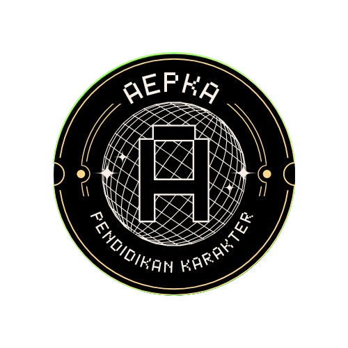

# 🎮 AEPKA (Aplikasi Edukasi Pendidikan Karakter Anak)

<p align="center">
  
</p>

<p align="center">
  <strong>Platform Pembelajaran Interaktif Berbasis Gamifikasi Retro 8-bit untuk Membentuk Karakter dan Moral Anak Sejak Dini.</strong>
</p>

<p align="center">
  
  
  
  
  
</p>

---

## 📖 Tentang AEPKA

**AEPKA** (*Aplikasi Edukasi Pendidikan Karakter Anak*) adalah aplikasi mobile berbasis Android yang dirancang khusus untuk memfasilitasi penanaman nilai-nilai moral, etika, dan budi pekerti luhur bagi anak-anak. Mengusung konsep **Gamified Learning** dengan tema visual bergaya **Retro 8-Bit (NES UI)**, AEPKA menyajikan materi pendidikan karakter secara menyenangkan, interaktif, dan mudah dipahami oleh anak.

---

## ✨ Fitur Utama

- 📚 **Edukasi Pendidikan Karakter**
  Menyediakan materi pembelajaran multimedia berupa video edukatif interaktif mengenai gotong royong, tanggung jawab, kejujuran, dan sopan santun.
- 💡 **Materi & Nilai Moral**
  Modul cerita dan skenario kehidupan sehari-hari yang melatih kepekaan empati dan penalaran moral anak.
- 🎯 **Kuis Interaktif & Tantangan Seru**
  Sistem evaluasi pemahaman materi dengan soal-soal interaktif yang ramah anak.
- ⚡ **Gamifikasi & Sistem EXP**
  Setiap penyelesaian kuis dan materi akan memberikan poin pengalaman (*Experience Points* / EXP) untuk menaikkan level profil anak.
- 🏆 **Leaderboard / Papan Peringkat**
  Peringkat skor *real-time* antar siswa untuk menumbuhkan motivasi belajar yang positif dan kompetitif.
- 🔒 **Autentikasi & Sinkronisasi Cloud**
  Sistem login dan profil pengguna terintegrasi penuh dengan Firebase Authentication & Cloud Firestore untuk penyimpanan data yang aman dan *real-time*.
- 🕹️ **Estetika Visual Retro NES (8-Bit)**
  Antarmuka unik bernuansa game klasik 8-bit dengan tipografi pixel art yang menarik perhatian anak dan tidak membosankan.

---

## 🛠️ Arsitektur & Teknologi

| Komponen | Teknologi | Keterangan |
|---|---|---|
| **Framework** | [Flutter](https://flutter.dev/) | Cross-platform UI toolkit |
| **Bahasa Pemrograman** | [Dart](https://dart.dev/) | Bahasa utama pengembangan aplikasi |
| **UI Components** | `nes_ui`, `google_fonts` | Komponen visual bertema NES retro 8-bit |
| **Media Player** | `youtube_player_flutter`, `video_player` | Streaming & pemutaran materi video |
| **Backend & Database** | Firebase Cloud Firestore, Firebase Realtime Database | Basis data NoSQL real-time |
| **Autentikasi** | Firebase Auth | Pengelolaan akun pengguna |
| **Local Storage** | `shared_preferences` | Manajemen sesi login offline & preferensi |
| **Build Tools** | Gradle 8.14+, Android Gradle Plugin 8.11+, OpenJDK 17 | Lingkungan build Android modern |

---

## 📁 Struktur Direktori Proyek

```text
AEPKA/
├── android/                 # Konfigurasi native Android (Gradle, Manifest)
├── assets/                  # Aset gambar, background, dan ikon
│   ├── background/          # Background visual aplikasi
│   ├── gamebg/              # Ilustrasi cerita dan materi edukasi
│   └── icon/                # Ikon aplikasi
├── lib/                     # Kode sumber aplikasi Flutter
│   ├── src/                 # Kustomisasi komponen widget NES UI & tema
│   ├── exp_calculator.dart  # Logika perhitungan level & EXP
│   ├── firebase_options.dart# Konfigurasi Firebase per platform
│   ├── gamelogic.dart       # Logika gamifikasi & reward
│   ├── homepage.dart        # Halaman utama (Dashboard)
│   ├── leaderboard.dart     # Papan peringkat siswa
│   ├── login.dart           # Layar masuk akun
│   ├── main.dart            # Titik masuk utama aplikasi (Entry point)
│   ├── materikarakter_page.dart # Modul video pembelajaran karakter
│   ├── moral_page.dart      # Modul bacaan nilai moral
│   ├── profile.dart         # Halaman profil siswa
│   ├── quiz_page.dart       # Modul kuis interaktif
│   ├── RegisterPage.dart    # Pendaftaran pengguna baru
│   └── session_manager.dart # Penyimpanan sesi login lokal
├── pubspec.yaml             # Manajemen dependensi dan aset
└── README.md                # Dokumentasi proyek
```

---

## 🚀 Memulai Pengembangan (Getting Started)

### 1. Prasyarat Sistem
Pastikan perangkat pengembangan Anda sudah terinstal:
- [Flutter SDK](https://flutter.dev/docs/get-started/install) (`>= 3.22.0`)
- [Dart SDK](https://dart.dev/get-dart) (`>= 3.3.0`)
- [OpenJDK 17](https://openjdk.org/)
- [Android Studio](https://developer.android.com/studio) / Android SDK (API level 34 atau 36)
- [Firebase CLI](https://firebase.google.com/docs/cli)

### 2. Kloning Repository
```bash
git clone https://github.com/ARZzxz/AEPKA.git
cd AEPKA
```

### 3. Instalasi Dependensi
Ambil seluruh paket dependensi proyek:
```bash
flutter pub get
```

### 4. Konfigurasi Firebase
Pastikan file `google-services.json` diletakkan pada:
```text
android/app/google-services.json
```
Jika perlu mengonfigurasi ulang project Firebase:
```bash
flutterfire configure
```

### 5. Menjalankan Aplikasi
Hubungkan perangkat Android fisik (via USB debugging) atau jalankan Emulator Android, kemudian ketik:
```bash
flutter run
```

Untuk melakukan build APK (Debug):
```bash
flutter build apk --debug
```

Untuk build APK siap rilis:
```bash
flutter build apk --release
```

---

## 👨‍💻 Kontribusi

Kontribusi, saran, dan pelaporan isu sangat terbuka untuk pengembangan AEPKA ke depan:
1. *Fork* repositori ini
2. Buat branch fitur baru (`git checkout -b feature/FiturKeren`)
3. *Commit* perubahan Anda (`git commit -m 'feat: Tambah fitur kuis baru'`)
4. *Push* ke branch (`git push origin feature/FiturKeren`)
5. Buka sebuah **Pull Request**

---

## 📄 Lisensi & Hak Cipta

Dikembangkan oleh **[ARZzxz](https://github.com/ARZzxz)**.  
Hak Cipta © 2026 Proyek Edukasi Karakter AEPKA.
